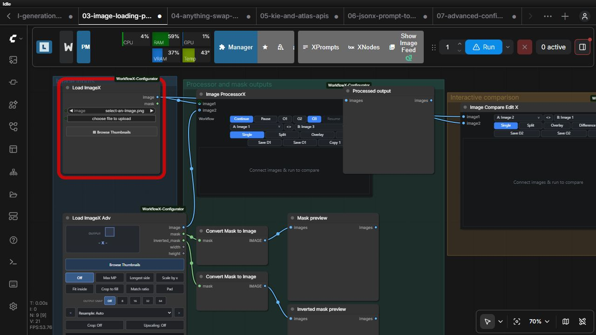

# WorkflowX image loaders

WorkflowX provides a standard loader and an advanced loader. Both return normalized image/mask tensors and can load annotated temporary images received from Image TargetX.

For automatic, free-floating image handoffs between native or WorkflowX loaders, see [Image SourceX and Image TargetX](EXECUTION_CONTROLS.md#image-sourcex-and-image-targetx). Copies reach muted or bypassed destination loaders while preserving their modes. Load ImageX Adv switches to Direct automatically.

## Load ImageX

Choose or upload an image. The node returns `IMAGE` and an alpha-derived `MASK`, following the familiar ComfyUI loader contract.

In **Browse Thumbnails**, enable batch selection, select input images, and choose **Delete**. Confirming permanently removes the selected files from ComfyUI's input directory. Saved workflows that reference a deleted image need a replacement.

## Load ImageX Adv

The advanced loader adds mask editing, an inverted mask, and explicit width/height outputs. Its `workflowx_state` field is managed by the frontend editor and saved in the workflow; do not wire or edit it as an ordinary input.

**Mode** offers **Normal**, **Direct**, and **From Node**. Normal (the default for existing workflows) uploads to ComfyUI inputs. Direct routes Upload Photo, image drag-and-drop, and image clipboard paste to a private temporary slot instead. Select the node or focus its controls before pasting. Text paste and node copy/paste are unaffected.

Direct retains the original file bytes, including alpha and multi-frame data. Each live node instance reuses one temporary file, atomically replacing it after validation. Different nodes/tabs use separate slots. Mode changes apply to the next upload and never move or delete the current source. Browse Thumbnails still selects existing input images.

ComfyUI temp cleanup can remove temporary images across restarts. Saved workflows retain the mode and source reference. Replace a missing Direct image by uploading or pasting it again. Duplicates initially reference the same image, then use separate slots for later uploads. Queue work after the intended image is loaded so an in-flight refresh cannot change what a waiting job reads.

### From Node

1. Connect the Stage 1 image producer to **ImageX Source**, then forward ImageX Source's `IMAGE` output to **Save Image** if you want to save it. Include ImageX Source in the Stage 1 run; native Save Image has no image output to connect back from.
2. In Stage 2, set **Load ImageX Adv** to **From Node** and select the source on the same workflow canvas. Sources with the same title show their node IDs.
3. Click **Refresh Image**. A single-image capture is copied immediately. For a batch, pick a thumbnail. Cancelling the picker keeps the current image.
4. Queue Stage 2. Its loader has its own temporary copy, so running Stage 1 again only updates the source capture.

The copy uses the same temp storage and image processing as Direct. After temp cleanup, rerun Stage 1 and refresh again.

See the [working image-tools example](../examples/03-image-loading-processing-and-comparison.json) and the [canonical contracts](../README.md#image-and-media-loading).
