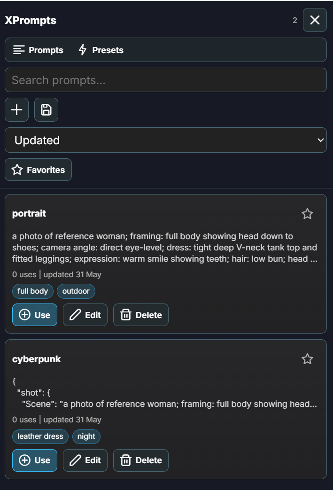
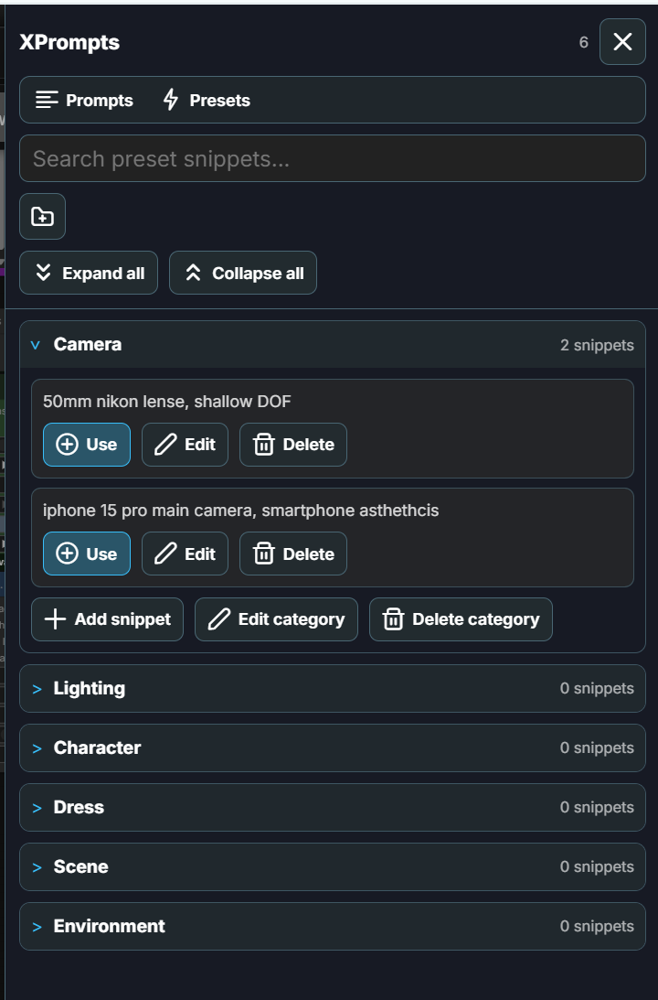

# XPrompts

XPrompts stores reusable prompts and preset blocks in a searchable sidebar library.

Prompt cards support quick inspection and reuse. Preset sections can remain collapsed for browsing or expanded for editing and insertion.

Choose **Open image prompt library** to index prompts embedded in local images and review similar prompt groups. The image library keeps its own index alongside the saved XPrompts library. [Image Prompt Library guide](image-prompt-library.md)

Keep credentials and personal paths out of prompt records intended for sharing. XPrompts complements, but does not replace, the structured JsonX and Unified Autoprompter nodes.
